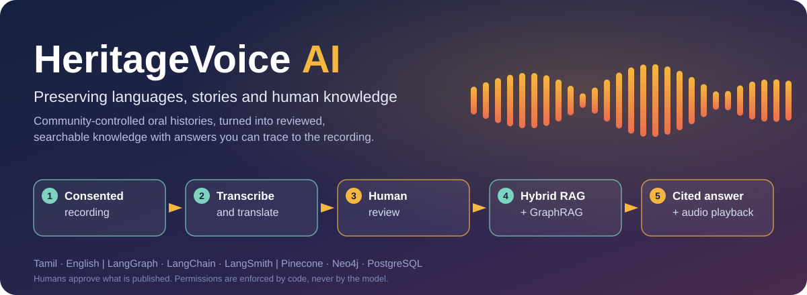

# HeritageVoice AI


Community-controlled oral-history preservation: record songs, stories, lessons and practices in
your own language, keep them with the consent of the people who shared them, and let anyone ask
questions and get answers that point back to the original voices.

> **Status: working MVP, pre-release.** The full path from upload to a cited answer is built and
> tested with fakes; it has not yet been validated on a large real collection. Use synthetic or
> explicitly approved material until you have reviewed the [security notes](SECURITY.md) and
> [deployment guide](docs/runbooks/deploy-single-instance.md) for your own context.

## What it does

- **Contribute.** Record in the browser or upload audio or MP4 in 17 languages. Share with a family
  or group, or openly with everyone; either way the speaker's consent is recorded first.
- **Review.** Speech is transcribed and translated, then people check it. Only approved,
  current versions are searchable.
- **Find.** Anyone can search the openly shared recordings without an account. Signed-in people also
  search what their groups share.
- **Ask.** Questions are answered from the recordings only: keyword and meaning-based search,
  plus a reviewed knowledge graph for "how are these connected" questions. Every claim is checked
  against its sources, answers carry citations, and you can listen to the cited moment.
- **Stay in control.** Groups and coordinators, consent that can be withdrawn at once, "report this
  item", an audit trail, and remedies that always carry a "not medically validated" notice.
- **Administer.** Choose the language models for each job (with fall-backs), keep API keys in AWS
  Parameter Store (never shown again), and review proposed relationships.

## How it works



```text
Preservation   audio + consent → transcription → translation → human review
                              → approved search indexes and reviewed graph relationships

Question       trusted identity → question rewrite → supervisor → text and/or graph search
answering                      → merge → verify claims → write answer → final permission check
```

PostgreSQL is the source of truth for records, consent, review state and keyword search. Pinecone
and Neo4j hold **rebuildable copies** of approved content, and every result is re-checked against
PostgreSQL before it reaches a prompt or a reader. Access is default-deny and decided on the
server; nothing a client or a model says can widen it.

| Part | Technology |
| --- | --- |
| API, worker | Python 3.12, FastAPI, background jobs in PostgreSQL |
| Interface | Streamlit |
| Orchestration, agents | LangGraph, LangChain (Anthropic and OpenAI models, with fall-backs) |
| Records, keyword search | PostgreSQL 16 (full-text search), Alembic migrations |
| Meaning-based search | Pinecone |
| Knowledge graph | Neo4j |
| Sign-in, speech | Amazon Cognito, Amazon Transcribe |
| Hosting | One small AWS instance, Terraform, GitHub Actions (OIDC, no stored AWS keys) |

## Quick start (local)

Prerequisites: [uv](https://docs.astral.sh/uv/), Python 3.12 and Docker (for PostgreSQL).

```sh
uv sync --locked
cp .env.example .env                  # then set a strong HERITAGEVOICE_DEV_API_TOKEN and the database URL
docker compose --profile infrastructure up -d postgres
uv run alembic upgrade head
uv run uvicorn app.api.main:app --reload --host 127.0.0.1      # API    http://127.0.0.1:8000/docs
uv run python -m app.worker                                      # background jobs (new terminal)
uv run python -m streamlit run frontend/streamlit_app.py --server.address 127.0.0.1   # UI http://127.0.0.1:8501
```

The development token is a local access gate, not user authentication. Full walkthrough:
[`docs/runbooks/setup.md`](docs/runbooks/setup.md). New to the code? Read the
[code guide](docs/code-guide.md). `uv run python -m app.skeleton` runs one fixture end to end with
in-memory fakes and prints a cited answer.

## Documentation

| Topic | Where |
| --- | --- |
| Run it locally | [`docs/runbooks/setup.md`](docs/runbooks/setup.md) |
| Deploy to AWS and approval gates | [`docs/runbooks/deploy-single-instance.md`](docs/runbooks/deploy-single-instance.md) |
| Repository settings for maintainers | [`docs/runbooks/repository-settings.md`](docs/runbooks/repository-settings.md) |
| Accounts, roles, groups and consent | [`docs/runbooks/accounts.md`](docs/runbooks/accounts.md), [`sharing.md`](docs/runbooks/sharing.md) |
| Models, keys and services | [`docs/runbooks/models.md`](docs/runbooks/models.md), [`integrations.md`](docs/runbooks/integrations.md), [`secrets.md`](docs/runbooks/secrets.md) |
| Search and answering | [`docs/runbooks/retrieval.md`](docs/runbooks/retrieval.md), [`answering.md`](docs/runbooks/answering.md) |
| Languages | [`docs/runbooks/languages.md`](docs/runbooks/languages.md) |

## Quality standards

Every change must pass these checks (also run by CI):

```sh
uv run ruff check . && uv run ruff format --check .
uv run mypy
uv run xenon --max-absolute A --max-modules A --max-average A app ingestion frontend
uv run pytest
```

- Cyclomatic complexity of at most 5 per function, at most 4 arguments, strict typing.
- Every access rule has a test for the denied case. Authorization comes only from the server-side
  principal, never from model output or request data.
- Dependencies are locked: change `pyproject.toml`, run `uv lock`, and regenerate
  `requirements.txt` (see [CONTRIBUTING.md](CONTRIBUTING.md)).
- Secrets and restricted recordings never enter Git; a commit hook, CI and tests enforce it.

## Project layout

```text
app/api/          HTTP endpoints
app/agents/       Question rewrite, supervisor, retrieval, graph search, verifier, answer, extractor
app/graph/        LangGraph workflows and typed state
app/adapters/     Pinecone, Neo4j, Cognito, Transcribe, S3 and model providers
app/db/           Tables and repositories
app/models/       Shared contracts
app/retrieval/    Keyword and vector search, fusion, eligibility checks
app/security/     Principal, roles and permissions
frontend/         Streamlit interface and legal pages
migrations/       Alembic migrations
infra/            Terraform (Cognito, single-instance hosting, CI roles)
deploy/           Container stack and deploy scripts
evals/            Retrieval evaluation harness and synthetic fixtures
docs/             Runbooks and the code guide
```

## Contributing

Contributions are welcome. Please read [CONTRIBUTING.md](CONTRIBUTING.md) and the
[Code of Conduct](CODE_OF_CONDUCT.md). Report security problems privately, as described in
[SECURITY.md](SECURITY.md). Every pull request needs a maintainer's approval before it is merged,
and nothing is deployed without a maintainer approving the deployment.

## License

Apache License 2.0. See [`LICENSE`](LICENSE).
