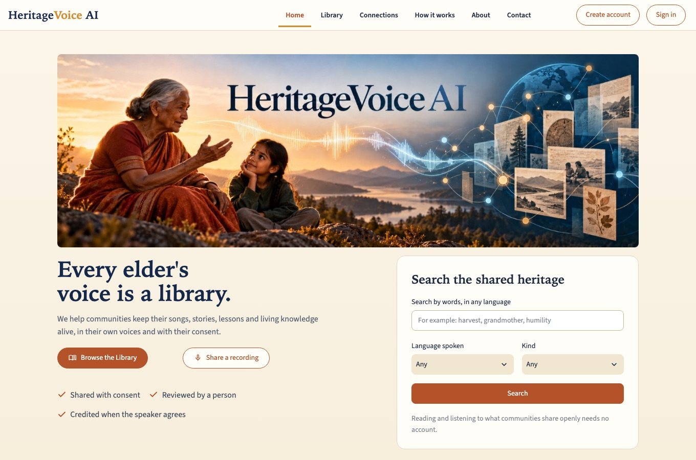
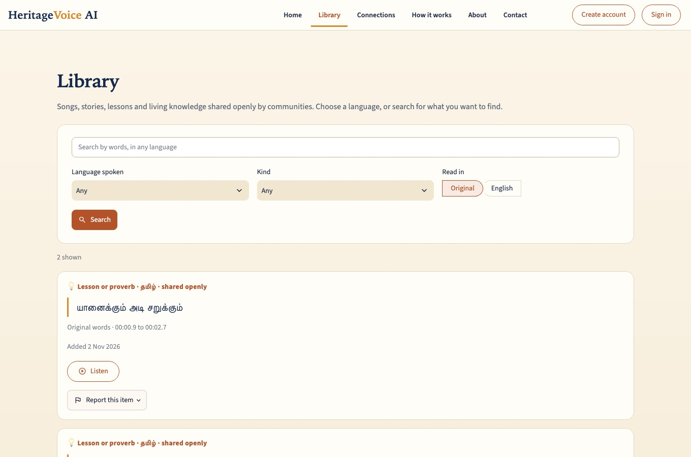
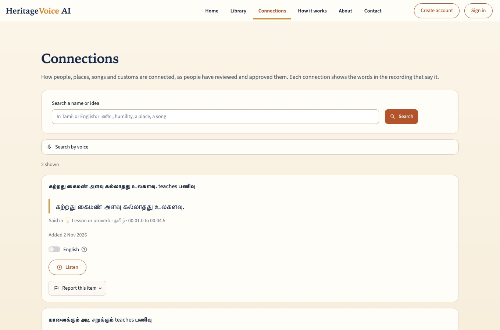
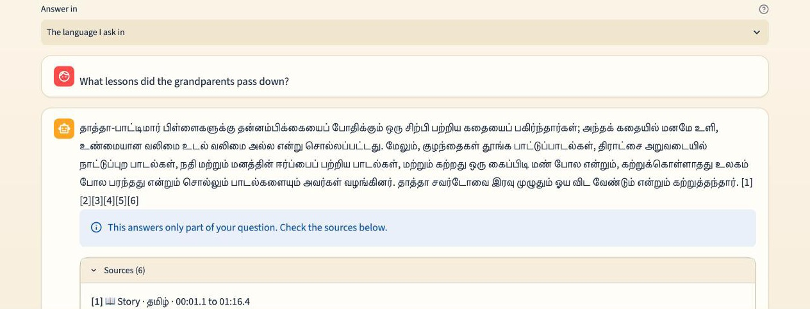
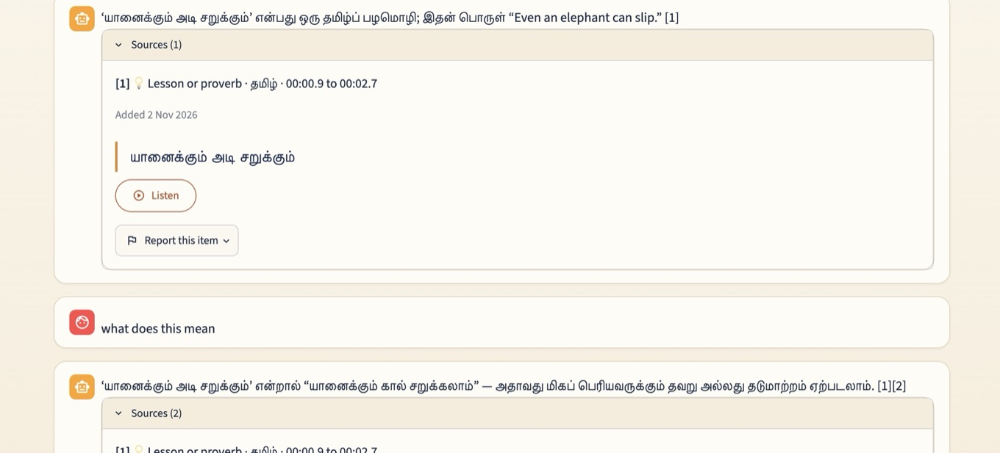
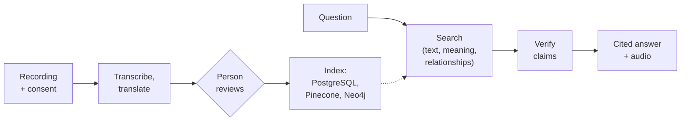

# HeritageVoice AI


> **Our goal:** preserve the voices of today so future generations can hear, learn from and
> understand the wisdom of the past, with communities, not AI, in control of their own heritage.

**A community-controlled platform that turns consented oral histories into reviewed, searchable
knowledge, and answers questions with citations that lead back to the original voice.**

[Live site](https://heritagevoice.org) · [Slides](https://claude.ai/artifact/Lht5ZxsiZQod3t4KjESkP8) · [Try it](#try-it) ·
[Documentation](#documentation) · [Contributing](#contributing)

**Status: early stage, live, single operator.** The platform works end to end and runs at
[heritagevoice.org](https://heritagevoice.org) with a small amount of demonstration content. It is
not yet ready for large collections of real community recordings: see
[Status and limitations](#status-and-limitations).

| Home: search and the three promises | Library: browse, filter, listen | Connections: a relationship and its words |
| --- | --- | --- |
|  |  |  |

**Ask:** a question in English, answered in Tamil from the community's own recordings. Every claim
carries a numbered source, and the list below it shows the recording, the moment and who shared it.
Signing in is needed to ask.



**Follow-up:** "what does this mean" is understood from the chat so far. The answer cites the proverb's
own recording, and **Listen** plays that moment in the speaker's voice.



Signed-in flow: record or upload → an administrator reviews the transcript and translation → ask a
question → read the answer with its citation and play the cited moment.

## Try it

| Path | What you get | You need | Cost |
| --- | --- | --- | --- |
| **1. Explore the live site** | Browse and search what communities shared openly, listen, follow Connections, in Tamil or English. No account. | A browser | Free |
| **2. Run the synthetic demo** | One synthetic recording is ingested, reviewed and questioned in memory, and a cited answer is printed. Fakes stand in for speech, models and databases. | [uv](https://docs.astral.sh/uv/) and Python 3.12 | Free; no keys, no Docker, no network |
| **3. Run the full app locally** | API, worker and interface against a local PostgreSQL. | uv, Python 3.12, Docker | Free by default. Real transcription (Amazon Transcribe, about $0.024 per audio minute), model answers (Anthropic or OpenAI), Pinecone and Neo4j are optional and use your own accounts and keys |

**Synthetic demo**

```sh
uv sync --locked
uv run python -m app.skeleton
```

Expected output (synthetic Tamil/English fixtures; the answer is a fake translation):

```text
ingest status: review (2 segments)
before approval: insufficient_evidence
after approval: answered
answer: [en] Synthetic elder describes seasonal wells. [rec-1:s1:v1]
  cite rec-1:s1:v1 at audio:rec-1?t=0.0-4.0
```

Note what it shows: nothing is searchable before a person approves it.

**Full application**

```sh
uv sync --locked
cp .env.example .env                  # then set a strong HERITAGEVOICE_DEV_API_TOKEN and the database URL
docker compose --profile infrastructure up -d postgres
uv run alembic upgrade head
uv run uvicorn app.api.main:app --reload --host 127.0.0.1      # API    http://127.0.0.1:8000/docs
uv run python -m app.worker                                      # background jobs (new terminal)
uv run python -m streamlit run frontend/streamlit_app.py --server.address 127.0.0.1   # UI http://127.0.0.1:8501
```

The development token is a local access gate, not user authentication. Without keys the AI steps do
not run (no translation, no model-written answers); locally, speech-to-text can be a canned fake.
Full walkthrough: [`docs/runbooks/setup.md`](docs/runbooks/setup.md).

## Why this project exists

Every language carries generations of stories, traditions and knowledge. Many are disappearing as
fewer people speak them and younger generations lose the chance to learn them. Smaller communities
have few tools to document their heritage, and general-purpose AI tools make two things worse:

- **They guess.** A chatbot can invent a "traditional remedy" or a "village history" that no elder
  ever told. For heritage knowledge, an invented answer is worse than no answer.
- **They ignore ownership.** Communities need to decide who may hear a recording, and to change
  their mind later.

The goal is not to replace native speakers or cultural experts. It is to give communities better
tools to preserve and share their own heritage.

| Principle | What it means in practice |
| --- | --- |
| **Consent first** | Nothing is processed or shared until the speaker's consent is recorded. Consent can be withdrawn and takes effect at once. |
| **Humans decide** | AI drafts transcripts, translations and relationships. People review them. Only approved material is searchable. |
| **Grounded answers** | Answers are written from the recordings only, checked against their sources, and carry citations. If the recordings do not say, the answer says so. |
| **Default-deny access** | The server decides who may see what. Nothing a client or a model says can widen it. |
| **Community-controlled** | Families and groups, coordinators and open sharing, chosen by the people who own the knowledge. |

## What it does

- **Contribute.** Record in the browser or upload audio or MP4 in 17 languages. Share with a family
  or group, or openly; either way the speaker's consent is recorded first. Optionally credit the
  speaker and say where the knowledge came from (a family elder, a book, a website).
- **Review.** Speech is transcribed and translated, then people check it. Only approved, current
  versions are searchable.
- **Find.** Anyone can search the openly shared recordings without an account.
- **Ask.** Questions are answered from the recordings only, with citations; you can listen to the
  cited moment. Examples: *"What song is sung at the rice harvest?"*, *"What does the proverb about
  the elephant mean?"*, *"How are these two families connected?"*
- **Follow connections.** The Connections page shows how people, places, songs and customs are
  linked, each with the words in the recording that say it. Search by typing or by voice, in the
  speaker's language or in English, and switch any connection to English. Only relationships a
  person approved are shown.
- **Stay in control.** Groups and coordinators, withdrawable consent, "report this item", an audit
  trail, and remedies that always carry a "not medically validated" notice.
- **Administer.** Approve people and manage roles, choose the language models for each job (with
  fall-backs), see model usage and cost, keep API keys in AWS Parameter Store (never shown again),
  and review proposed relationships.

## How it works, in short

Two flows meet in the data stores. **Preservation** turns a recording into approved knowledge;
**question answering** turns a question into a cited answer.



PostgreSQL is the source of truth; Pinecone and Neo4j hold rebuildable copies, and every result is
re-checked against PostgreSQL for approval, consent and the reader's access. Agents each do one job
and cannot grant access. Details: [How it works](docs/how-it-works.md) (flows, agents, hybrid and
graph retrieval), [data stores](docs/schema/README.md), and [decision records](docs/adr/README.md).

Built with Python 3.12, FastAPI, Streamlit, LangGraph and LangChain (Anthropic and OpenAI models),
PostgreSQL 16, Pinecone, Neo4j, Amazon Cognito and Transcribe, on one AWS instance with Terraform and
GitHub Actions.

## Consent, privacy and ownership

| Question | Short answer |
| --- | --- |
| **Who receives my data?** | **Amazon Web Services** hosts everything: the private audio bucket, speech-to-text (Transcribe) and sign-in (Cognito). **Language-model providers** (Anthropic, OpenAI) receive text: transcripts, retrieved passages and questions, never audio. **Pinecone** receives passage text to compute embeddings and stores vectors only. Tracing (LangSmith) is off by default. |
| **What becomes public?** | Only a recording that an administrator approved, that was set to public, and whose consent allows public sharing. Visitors can read and play it. The speaker's name is shown only if the consent allows crediting. |
| **What if consent is withdrawn?** | The recording leaves search, answers, Connections and playback at once; a background job removes its vectors. The audio file is kept, unserved, in the private bucket until the operator deletes it; automatic purging is not built yet. |
| **Backups?** | Daily disk snapshots of the server, kept for 7 days. Anything deleted from the live system ages out of backups with them. |
| **Who owns what?** | The software is open source (Apache 2.0). That licence covers **the code only**. It gives no right to any recording, transcript or cultural knowledge: those stay with the speakers and communities, under the consent they gave. |

Details: [privacy notice](frontend/legal/privacy.md), [terms of use](frontend/legal/terms.md),
[sharing rules](docs/runbooks/sharing.md). This is a summary, not legal advice.

## Evaluation

A passing test suite is not a quality evaluation. The only published results so far are a first
retrieval run on synthetic data (below); everything else is **not published yet**.
What exists today:

- About 1,400 automated tests, including an access test for every denied case.
- A development fixture set: **6 synthetic recordings** (Tamil and English) and **12 questions** (4
  exact-term, 3 paraphrase, 3 relationship, 2 unsupported), with a small harness
  (`uv run python -m evals.retrieval_check`). The fixtures are synthetic and need review by a native
  Tamil speaker before they count as ground truth.
- A multilingual **synthetic demo library** (nine languages, `app/demo_recordings.json`) with 16 more
  questions, and a LangSmith experiment runner (`uv run python -m evals.langsmith_eval --local`).

| Area | What will be published | Status |
| --- | --- | --- |
| Retrieval | Recall@k on a labelled set | First run published ([report](evals/results/published/)): 24 of 24 synthetic questions found in the top 5 with real multilingual embeddings (23 of 24 with a fake word-based index); a small synthetic set, so not a rate for real recordings |
| Answer quality | Supported-claim rate and citation correctness | Pending |
| Unsupported questions | How often the system correctly declines | Pending |
| Languages | Results per language, reviewed by native speakers | Per-language scores published (mostly one question each); native review pending |
| GraphRAG | Compared with hybrid search on relationship questions | Pending |
| Operations | Latency and cost for a declared workload | Pending |

Each result will state the dataset size, whether it is synthetic or real, model versions,
configuration and date ([plan](evals/README.md)). Transcription, translation, retrieval and
verification can all still be wrong; that is why people review material and readers can report it.

## Status and limitations

- **One small server.** No failover and no point-in-time recovery; backups are daily snapshots for
  7 days, and a restore has not been rehearsed. Use synthetic or explicitly approved data until a
  managed setup (database service, load balancer) replaces it.
- **Language quality is unmeasured.** Seventeen languages are accepted, but speech-to-text,
  translation and search quality have not been checked per language by native speakers.
- **Small catalogue.** There are only a few approved recordings, so answers and connections are
  limited.
- **Data removal is partly manual.** Withdrawing consent hides material at once, but deleting the
  stored audio is a manual step for the operator.

## Roadmap

Published evaluation results · a place of origin for each recording · an audit-log viewer and
export · a rehearsed backup restore and a managed database · automatic purging of withdrawn audio ·
shorter sign-in tokens with silent refresh.

## Documentation

| Topic | Where |
| --- | --- |
| **Presentation slides**: the problem, the architecture, the agents and the results | [Slides](https://claude.ai/artifact/Lht5ZxsiZQod3t4KjESkP8) |
| How it works: flows, agents, retrieval | [`docs/how-it-works.md`](docs/how-it-works.md) |
| **Data stores**: PostgreSQL tables, vector index, graph | [`docs/schema/`](docs/schema/README.md) |
| **Why it is built this way** (decision records) | [`docs/adr/`](docs/adr/README.md) |
| Code layout and conventions | [`docs/code-guide.md`](docs/code-guide.md) |
| Run it locally | [`docs/runbooks/setup.md`](docs/runbooks/setup.md) |
| Deploy to AWS and approval gates | [`docs/runbooks/deploy-single-instance.md`](docs/runbooks/deploy-single-instance.md) |
| Moving the site to a new domain | [`docs/runbooks/change-domain.md`](docs/runbooks/change-domain.md) |
| Repository settings for maintainers | [`docs/runbooks/repository-settings.md`](docs/runbooks/repository-settings.md) |
| Accounts, roles, groups and consent | [`docs/runbooks/accounts.md`](docs/runbooks/accounts.md), [`sharing.md`](docs/runbooks/sharing.md) |
| Models, keys and services | [`docs/runbooks/models.md`](docs/runbooks/models.md), [`integrations.md`](docs/runbooks/integrations.md), [`secrets.md`](docs/runbooks/secrets.md) |
| Search and answering | [`docs/runbooks/retrieval.md`](docs/runbooks/retrieval.md), [`answering.md`](docs/runbooks/answering.md) |
| Connections: search, English and voice | [`docs/runbooks/connections.md`](docs/runbooks/connections.md) |
| Correcting relationships by voice | [`docs/runbooks/voice-correction.md`](docs/runbooks/voice-correction.md) |
| Languages | [`docs/runbooks/languages.md`](docs/runbooks/languages.md) |
| Sign-in domain (Cognito) | [`docs/runbooks/login-domain.md`](docs/runbooks/login-domain.md) |
| Access tests (the denied cases) | [`docs/runbooks/access-tests.md`](docs/runbooks/access-tests.md) |

## Quality standards

Every change must pass these checks (also run by CI):

```sh
uv run ruff check . && uv run ruff format --check .
uv run mypy
uv run xenon --max-absolute A --max-modules A --max-average A app ingestion frontend
uv run pytest
```

Complexity of at most 5 per function, at most 4 arguments, strict typing. Every access rule has a
test for the denied case. Dependencies are locked (see [CONTRIBUTING.md](CONTRIBUTING.md)). Secrets
and restricted recordings never enter Git; a commit hook, CI and tests enforce it.

## Project layout

```text
app/        API, agents, workflows, adapters (Pinecone, Neo4j, Cognito, Transcribe, S3, models),
            database, retrieval, security
frontend/   Streamlit interface and legal pages
ingestion/  Helpers for text sources
migrations/ Alembic migrations
infra/      Terraform (Cognito, single-instance hosting, CI roles)
deploy/     Container stack and deploy scripts
evals/      Retrieval evaluation harness and synthetic fixtures
tests/      Unit, access and end-to-end tests
docs/       How it works, data-store schemas, decision records, runbooks, code guide
```

## Contributing

Contributions are welcome. Please read [CONTRIBUTING.md](CONTRIBUTING.md) and the
[Code of Conduct](CODE_OF_CONDUCT.md). Report security problems privately, as described in
[SECURITY.md](SECURITY.md). Every pull request needs a maintainer's approval before it is merged,
and nothing is deployed without a maintainer approving the deployment.

## License

Apache License 2.0. See [`LICENSE`](LICENSE). The licence covers the software only, not the
recordings or the cultural knowledge in them.
