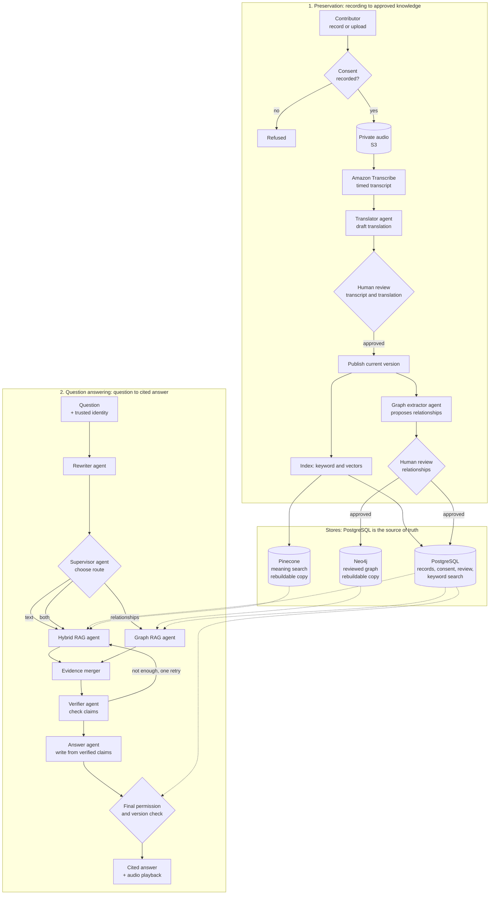

# How HeritageVoice works

The detail behind the [README](../README.md): the two flows, the technology, each agent, and how
retrieval works. For the stores see [schema/](schema/README.md); for why it is built this way see
[adr/](adr/README.md).

## The two flows

The system has two flows that meet in the data stores: **preservation** (turning a recording into
approved knowledge) and **question answering** (turning a question into a cited answer).

How to read it:

1. **A recording enters only with consent.** Audio is stored privately and transcribed with
   timestamps. A translation is drafted from the transcript.
2. **People approve before anything is searchable.** Drafts stay invisible to search until a
   reviewer approves them. A correction creates a new version and invalidates what was derived
   from the old one.
3. **Approved content is copied into search indexes.** PostgreSQL holds the truth and keyword
   search. Pinecone and Neo4j hold *rebuildable copies*: if either is lost or wrong, it is rebuilt
   from PostgreSQL.
4. **A question runs through a fixed pipeline of agents** (see below). Each retrieval result is
   re-checked against PostgreSQL, and a last permission and version check runs just before the
   answer is returned.
5. **The answer links back to the voice.** Citations point at the exact recording and time range,
   and an authorized reader can play that moment.

### Technology

| Part | Technology |
| --- | --- |
| API, worker | Python 3.12, FastAPI, background jobs in PostgreSQL |
| Interface | Streamlit |
| Orchestration, agents | LangGraph, LangChain (Anthropic and OpenAI models, with fall-backs) |
| Records, keyword search | PostgreSQL 16 (full-text search), Alembic migrations |
| Meaning-based search | Pinecone |
| Knowledge graph | Neo4j |
| Sign-in, speech | Amazon Cognito, Amazon Transcribe |
| Hosting | One small AWS instance, Terraform, GitHub Actions (OIDC, no stored AWS keys) |

## Agents

Each agent has one job, a typed input and output, and no power to grant access. Models are chosen
per job in the admin portal, with fall-backs, so a provider outage degrades one step instead of
the whole product. A step that cannot run records a warning and the pipeline carries on safely.

| Agent | Flow | Task | If it fails |
| --- | --- | --- | --- |
| **Translator** | Preservation | Drafts a translation of each transcript segment. Keeps cultural terms (names, places, kinship words, songs) and treats the transcript as data, never as instructions. | Review continues without a translation draft. |
| **Graph extractor** | Preservation | Reads an approved transcript and *proposes* relationships (person, place, event, practice, theme). Every proposal is checked for a real segment and a known relation, then stored as pending. | Nothing is proposed; nothing reaches the graph. |
| **Correction interpreter** | Preservation | Understands a reviewer's spoken correction of a proposed relationship. The reviewer sees the words it heard and what it wrote, can change either, and approves it themselves. | The reviewer types the change instead. |
| **Question rewriter** | Question | Turns a follow-up ("and her mother?") into a standalone question using the last few turns. Memory is stateless and never widens access. | The original question is used. |
| **Supervisor** | Question | Chooses the route: text search, graph search, both, ask for clarification, or refuse. It routes; it never grants access. | Falls back to text search with a warning. |
| **Hybrid RAG** | Question | Finds passages with keyword and meaning-based search, fuses the ranks and keeps the best five to eight. | Keyword results only, with a warning. |
| **Graph RAG** | Question | Finds relationship paths in the reviewed graph and loads the passages that support each edge. | The question is answered from text, with a warning. |
| **Evidence merger** | Question | Combines both branches, removing duplicates while keeping how each passage was found. | Not model-backed; errors surface. |
| **Verifier** | Question | Proposes the claims the passages actually support, each tied to the passages that say it. Claims citing a passage that was not shown are discarded. May ask for one more retrieval round. | Nothing is claimed: an unverified answer is never produced. |
| **Answer writer** | Question | Writes prose from verified claims only, in the reader's chosen language. Citations, remedy notices and disagreements between sources are added by code, so a model cannot leave them out. | The verified claims are shown as they are. |

Transcription is not an agent: Amazon Transcribe produces the timed transcript, and the
transcript is validated (non-empty, ordered, unique segment IDs) before it is saved.

The question agents run as a [LangGraph](https://langchain-ai.github.io/langgraph/) workflow with
typed state. The reader's identity is captured once on the server and cannot be changed by any
node; every retrieval result is checked against it, and the whole run has a deadline and at most
one retrieval retry.

## Retrieval: RAG and GraphRAG

### Why retrieval at all

A language model on its own does not know your community's recordings, and what it does know it
may state with confidence and get wrong. **Retrieval-Augmented Generation (RAG)** reduces this by
searching the approved recordings first and asking the model to answer *only* from what was found.
That aims at the three things heritage preservation needs: answers that come from the community's
own words, citations a person can follow, and the ability to say "the recordings do not say".
It does not make mistakes impossible: transcription, translation, retrieval and the verifier can
all still be wrong, which is why people review the material and readers can report an item.

### Hybrid RAG: finding the right passages

Oral-history questions are a mix of exact names and loosely worded ideas, in several languages,
so no single search is enough.

| Search | Good at | Weak at |
| --- | --- | --- |
| **Keyword** (PostgreSQL full-text) | Exact names, places, rare words, transliterated terms | Paraphrase and other wording |
| **Meaning-based** (Pinecone, multilingual embeddings) | Paraphrase, "same idea, different words", cross-language questions | Exact rare terms |

How we use them:

1. The original question is kept, and a normalized spelling is added without losing the source
   wording.
2. Each search returns up to 20 candidates. **The reader's permissions are applied inside both
   searches**, so restricted passages are never candidates.
3. Ranks are fused with reciprocal rank fusion (k=60) and duplicates are removed by recording,
   segment and version.
4. The best five to eight passages fit the context budget and move on.

If the vector search is down, keyword results are used and a warning is attached.

### GraphRAG: following connections

Some questions are about relationships, not passages: *"Who else mentions the harvest festival?"*,
*"How are these two families connected?"*, *"Which places appear in both stories?"* The answer is
spread across several recordings, so passage search alone misses it. A **knowledge graph** stores
who and what appear and how they relate, so one or two hops can join recordings that never mention
each other directly.

A graph built by a model alone would reintroduce guessing, so ours is *reviewed*:

1. After a transcript is approved, the **graph extractor** proposes relationships, each tied to the
   segment that says it.
2. A person approves or rejects each one on the Relationships page. Confidence never replaces
   review.
3. Approved relationships are written to Neo4j. PostgreSQL stays the source of truth.
4. At question time, **Graph RAG** asks Neo4j only for *candidate paths*. Every edge is then
   re-checked in PostgreSQL: still approved, about the transcript that is approved now, and the
   supporting passage still readable by this person. **A path with any failing edge is dropped
   whole**, so the graph can never reveal more than the text could.
5. What survives returns as ordinary evidence plus the path that led to it, and is merged with the
   Hybrid RAG results.

### When each is used

| Question | Route | Example |
| --- | --- | --- |
| Find a fact, name or story | Hybrid RAG | "What song is sung at the rice harvest?" |
| Relationships across recordings | Graph RAG, usually with Hybrid RAG | "How are these two families connected?" |
| Too vague | Ask to clarify | "Tell me about it." |
| Not allowed | Refuse | A request outside the recordings' purpose |

If Neo4j is not configured, relationship questions fall back to text search with a warning, so the
product works with PostgreSQL alone.

