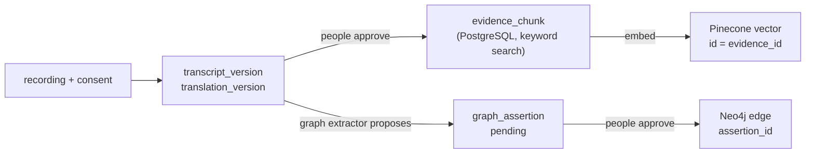

# Data stores

HeritageVoice keeps its data in three places. **PostgreSQL is the source of truth.** The other two
are copies that exist to make one kind of question fast, and either can be thrown away and rebuilt
from PostgreSQL (see [ADR 0001](../adr/0001-postgresql-is-the-source-of-truth.md)).

| Store | Holds | Used for | Rebuildable? | Details |
| --- | --- | --- | --- | --- |
| PostgreSQL 16 | Everything: recordings, consent, transcripts, reviews, accounts, audit trail, search text | Records, access checks, keyword search | No: this is the truth. Backed up. | [postgres.md](postgres.md) |
| Pinecone | One vector per approved passage, no text | Meaning-based search | Yes | [vector-index.md](vector-index.md) |
| Neo4j | Approved relationships between people, places, events and ideas | "How are these connected" questions | Yes | [graph.md](graph.md) |

Audio files are not in a database: they live in a private, encrypted S3 bucket, and the
`recording` table holds only the object key.

## How a recording reaches each store

Nothing is copied to Pinecone or Neo4j until a person has approved it, and a withdrawn consent or a
replaced version removes the copies again.

## Rules every store follows

- **Authorization is decided in PostgreSQL, on every request.** A namespace, a metadata filter or a
  graph pattern only narrows what is looked at; none of them is a permission check. Every hit from
  Pinecone or Neo4j is loaded again from PostgreSQL and dropped if it is no longer approved,
  current, consented and readable by this person.
- **No audio and no restricted text outside PostgreSQL.** Pinecone stores vectors and IDs only.
  Neo4j stores names and relationship types taken from approved assertions.
- **Changes go through Alembic.** Never edit tables by hand. A new column or table is a migration in
  `migrations/versions/`, with a test.

Related: [code guide](../code-guide.md), [retrieval runbook](../runbooks/retrieval.md).
