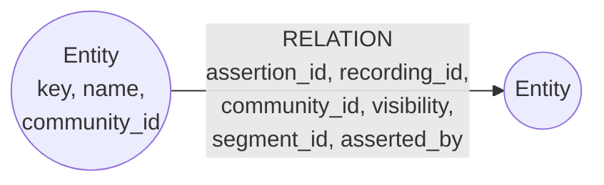

# Knowledge graph (Neo4j)

A rebuildable copy of the **approved** relationships, so "how are these connected" questions can
join recordings that never mention each other. Code: `app/adapters/neo4j_graph.py` (writing) and
`neo4j_reader.py` (reading). The source of truth is the `graph_assertion` table in PostgreSQL.

## Shape

**Node `Entity`**

| Property | Meaning |
| --- | --- |
| `key` | Unique (constraint `entity_key`): `{community_id}:{name, lower-cased, spaces collapsed}`. The same name in two communities is two nodes, so one community's graph never merges with another's. |
| `name` | The name as written. |
| `community_id` | The community it belongs to. |

**Relationship types** (a fixed list in `app/models/records.py`, never taken from text):

| Type | Read as |
| --- | --- |
| `MENTIONS` | mentions |
| `DESCRIBES` | is about |
| `OCCURRED_AT` | happened at |
| `RELATED_TO` | is related to |
| `TEACHES` | teaches |
| `SPOKE_IN` | spoke in |
| `SUPPORTED_BY` | is supported by |

**Relationship properties:** `assertion_id` (links back to PostgreSQL), `recording_id`,
`community_id`, `visibility`, `segment_id` (the supporting words), `asserted_by`.

## Rules

- **Only approved assertions of published recordings are written.** A pending or rejected
  relationship never reaches Neo4j.
- **Replacing a recording is one transaction:** its edges are removed, then any entity left without
  an edge, then the new edges are written.
- **Every value is a query parameter.** Relationship types come from the enum, so no user or model
  text is ever built into a query.
- **Neo4j only suggests paths.** For each edge on a candidate path, PostgreSQL checks that the
  assertion is still approved, is about the transcript that is approved now, and that the
  supporting passage is readable by this person. **A path with any failing edge is dropped whole.**
  The graph therefore cannot show more than the text could.
- **Rebuilding:** if Neo4j is lost or wrong, it is rewritten from the approved assertions. If it is
  not configured, relationship questions fall back to text search with a warning.

See [ADR 0003](../adr/0003-the-knowledge-graph-is-reviewed-by-people.md) and the
[retrieval runbook](../runbooks/retrieval.md).
