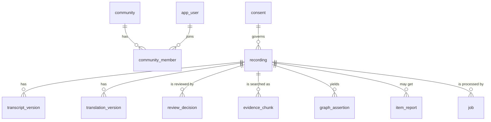

# PostgreSQL schema

The source of truth. Tables are defined in `app/db/tables.py` (SQLAlchemy) and created by the Alembic
migrations in `migrations/versions/`. Callers get domain models from `app/db/repositories/`, never
table rows. Types below are as declared in code; PostgreSQL stores `JSON` as `jsonb` and times as
UTC `timestamptz`. This page is checked against the tables when the schema changes.

## How the tables relate

`community_id` also appears on `recording`, `consent` and `evidence_chunk`, but as a plain value, not
a foreign key. A community id can be the reserved `everyone` (open sharing), which has no row in
`community`.

## Recordings and their consent

**`recording`**: one oral history item.

| Column | Meaning |
| --- | --- |
| `id` (PK) | Recording id. |
| `community_id`, `uploader_id` | Whose it is and who added it (a Cognito `sub`). |
| `language` | Spoken language code. |
| `consent_id` (FK `consent.id`) | The consent record that governs it. Required: no consent, no recording. |
| `heritage_kind` | `story`, `song`, `lesson`, `practice` or `remedy`. |
| `visibility` | `community` or `public`. |
| `status` | `draft` → `review` → `published`, or `revoked`. |
| `audio_key`, `content_type`, `size_bytes`, `duration_s` | Where the private audio is, and what it is. |
| `idempotency_key` | Stops a retried upload creating a second recording. Unique with `uploader_id`. |
| `credit_name`, `source_kind`, `source_note` | Optional credit: who to thank, where the knowledge came from (`own`, `family`, `elder`, `book`, `website`, `other`), and a short note. Shown to readers only if the consent includes `attribution`. |
| `created_at` | When it was added. |

Indexes: `status`, `community_id`, `visibility`.

**`consent`**: what the speaker or group agreed to, per recording.

| Column | Meaning |
| --- | --- |
| `id` (PK), `community_id` | |
| `rights` (JSON) | A list of granted rights: `playback`, `ai_processing`, `translation`, `indexing`, `summarization`, `attribution`, `public_sharing`. Each use is checked on its own. |
| `policy_version` | The terms the consent was given under. |
| `revoked` | Withdrawn consent. Takes effect at once: the recording leaves search and answers. |

## Transcripts, translations and review

**`transcript_version`**: `id`, `recording_id` (FK), `version`, `status`, `segments` (JSON: timed text with
segment ids), `created_by`. Unique on (`recording_id`, `version`). `status` is `draft`, `approved`,
`rejected` or `superseded`. A correction creates a new version; it never edits an old one.

**`translation_version`**: as above, plus `transcript_version` (the transcript it was made from) and
`target_language`. Unique on (`recording_id`, `target_language`, `version`).

**`review_decision`**: a person's yes or no. `id`, `recording_id` (FK), `subject` (`transcript`,
`translation` or `assertion`), `subject_version`, `reviewer_id`, `approved`, `note`, `decided_at`.

## Search text

**`evidence_chunk`**: the passages that search and answers use, built from approved versions only.

| Column | Meaning |
| --- | --- |
| `evidence_id` (PK) | `{recording}:{kind}:v{version}:c{chunk}`. The same id is used in Pinecone. |
| `recording_id` (FK), `community_id`, `visibility` | Copied so permissions can be applied inside the search query. |
| `kind` | `transcript` (original words) or `translation`. |
| `version`, `chunk_index`, `language` | Which version and which piece. |
| `text`, `passage_hash` | The passage and its hash. |
| `start_s`, `end_s`, `segment_ids` (JSON), `speaker` | Where in the audio it is, so a citation can play it. |

Keyword search runs on this table with PostgreSQL full-text search using the `simple`
configuration (no stemming or stop words, so names in any script match). Indexes: `community_id`,
`visibility`, `recording_id`.

## Relationships (before and after approval)

**`graph_assertion`**: a proposed or approved relationship.

| Column | Meaning |
| --- | --- |
| `id` (PK), `recording_id` (FK) | |
| `subject`, `relation`, `object` | For example *Amma* `TEACHES` *rice songs*. `relation` is one of a fixed list (see [graph.md](graph.md)). |
| `asserted_by` | The agent or person that proposed it. |
| `review_state` | `pending`, `approved` or `rejected`. Only `approved` is copied to Neo4j. |
| `supporting_segment_id`, `transcript_version` | The exact words that say it, and which transcript. |
| `confidence`, `policy_ref` | The model's confidence (never a substitute for review), and the policy applied. |

Indexes: `review_state`, `recording_id`.

## People and groups

**`app_user`**: `sub` (PK, the Cognito subject), `role` (`member`, `reviewer`, `admin`; people see
reviewer as Coordinator), `status` (`active` or `disabled`: a disabled person cannot sign in), `created_at`. No passwords are stored: Cognito holds them.

**`community`**: `id` (PK), `name`, `created_by`, `created_at`. A family or group.

**`community_member`**: (`user_sub` FK `app_user.sub`, `community_id`) as a composite primary key.

## Moderation and accountability

**`item_report`**: a reader's "report this item". `id`, `recording_id` (FK), `reason` (`private`,
`harmful`, `health`, `copyright`, other), `note`, `reporter`, `status`, `created_at`, `resolved_by`.
Indexes: `recording_id`, `status`.

**`audit_log`**: who did what. `id`, `actor_sub`, `action`, `target`, `trace_id`, `detail` (short, no
secrets or recording text), `at`. Append-only by convention: the application never updates or
deletes rows.

## Background work

**`job`**: the worker's queue, kept in PostgreSQL. `id`, `kind`, `status` (`queued`, `processing`,
`review`, `published`, `failed`), `error` (a safe code, never a message), `stage`, `attempts`,
`recording_id`, `created_at`, `updated_at`. Index: `status`.

## Language models and their cost

**`model_catalog`**: the models an administrator has added. `model_id` (PK), `provider`, `key_name`
(the name of the secret in AWS Parameter Store, never the key), `status` (`active`, `deprecated`,
`disabled`), `created_by`, `created_at`, `input_price`, `output_price` (per million tokens).

**`model_setting`**: which model does each job. `role` (PK, for example translator or verifier),
`provider`, `model`, `temperature`, `timeout_s`, `max_retries`, `fallbacks` (JSON), `updated_by`,
`updated_at`.

**`model_usage`**: tokens used per call. `id`, `at`, `role`, `model`, `input_tokens`,
`output_tokens`. Index: `at`. No prompts or answers are stored.

## What is deliberately not here

Passwords and API keys (Cognito and Parameter Store), audio (S3), vectors (Pinecone) and graph edges
(Neo4j).
